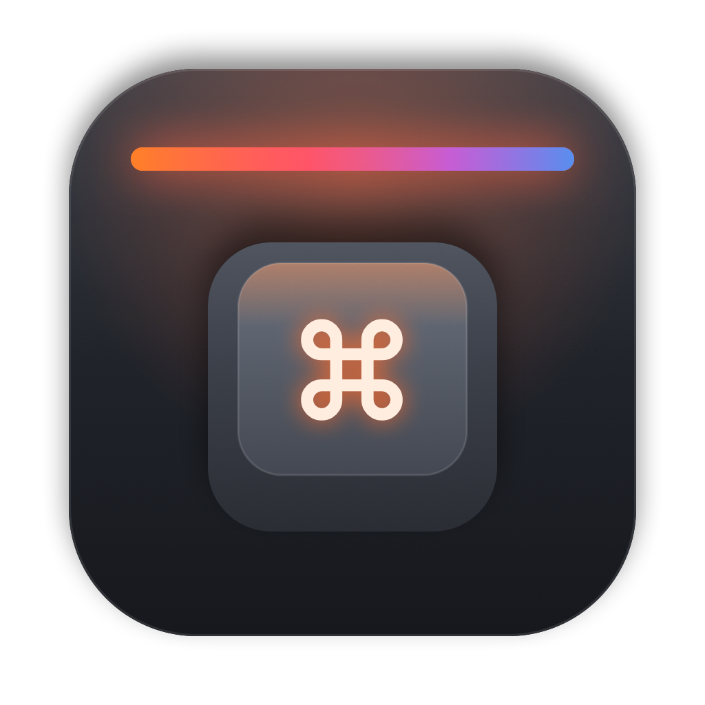

<p align="center"></p>

# OpenMount

**A native macOS app for configuring the be quiet! Light Mount keyboard.**

be quiet!'s IO Center only runs on Windows. OpenMount talks to the keyboard directly over USB, so
Mac users can change lighting, remap keys and record macros. Everything is saved on the keyboard
itself, so it keeps working on any computer.

> OpenMount is an independent, community project. It isn't affiliated with, endorsed by or
> supported by be quiet! GmbH. "be quiet!" and "Light Mount" are trademarks of their owner.

## Features

- **Lighting:** the six on-board effects (Static, Color Wave, Tornado, Breathing, Reactive,
  Matrix), with colour, brightness, speed and direction. Saved on the keyboard.
- **Per-key colours:** paint individual keys and the top light bar. Includes rainbow, WASD and
  fill presets.
- **Key remapping:** remap any key on the main layer or the Fn layer to another key or a
  shortcut, a media key, a mouse button, a lighting control or a macro. Keys can be captured by
  pressing them.
- **Language switch key:** make Fn (or Right Ctrl or Caps Lock) switch input languages, for
  example English ↔ Korean, without the app running. When Fn is used, the Fn layer moves to Right
  Ctrl so nothing is lost.
- **Mac modifier layout:** one switch swaps Win and Alt, so the keys next to the space bar are
  ⌘ Command and ⌥ Option, like on a Mac keyboard.
- **Language layouts:** see Korean (or another language) on screen when your keycaps only
  show English. It follows the macOS input source and can float above your other windows.
  Layouts are community-made: [add yours](Layouts/README.md).
- **Macros:** up to 10 on-keyboard macros. Record them from your keystrokes or generate them from
  text.
- **Menu-bar quick controls:** effect, brightness and lights off.
- **Backup / restore:** export your settings to JSON and import them again.
- **`omctl` command-line tool:** for scripting and debugging.

OpenMount **never updates firmware** and refuses to send firmware-update or serial-number
commands.

## Supported hardware

| Keyboard | USB ID | Status |
|---|---|---|
| Light Mount (full size, ANSI/ISO) | `373F:0002` | ✅ tested (firmware 0x35) |
| Light Mount TKL | `373F:0018` | ❓ probably works, untested; layout not drawn yet |
| Dark Mount | `373F:0001` | ❓ untested |

If you own one of the untested models, please open an issue with the output of `omctl info`.

## Install

1. Download `OpenMount-vX.Y.Z.dmg` from [Releases](../../releases) and open it.
2. Drag **OpenMount** onto the **Applications** shortcut. (A `.zip` is also attached if you prefer.)
3. The app isn't notarised yet, so the first time you open it, right-click it, choose **Open**,
   then **Open** again. Or run `xattr -dr com.apple.quarantine /Applications/OpenMount.app`.

It needs macOS 14 Sonoma or later and runs on Apple silicon and Intel. No drivers are needed, and
there's no Input Monitoring prompt: OpenMount only uses the keyboard's configuration interface.

## Build from source

```sh
git clone https://github.com/fjc1991/OpenMount.git
cd OpenMount
swift test               # protocol unit tests
./scripts/build-app.sh   # builds dist/OpenMount.app
./scripts/make-dmg.sh    # packages it as dist/OpenMount-vX.Y.Z.dmg
```

The CLI:

```sh
swift build
.build/debug/omctl info              # firmware, serial, supported features
.build/debug/omctl restore-default   # static be quiet! orange
.build/debug/omctl -v req 10 01      # raw request: feature 0x10, command 0x01
```

## Good to know

- **Per-key colours** use the keyboard's realtime mode. They're not stored in the keyboard's
  flash, so OpenMount re-applies them whenever the keyboard connects while the app is running.
  On-board effects from the Lighting page are permanent.
- The keyboard can't report its current effect, so OpenMount remembers the last one you set.
- **Reset to default** on a key (or **Reset all keys…**) restores the factory binding.

## How it works

The keyboard uses a framed request/response protocol over a vendor HID interface.
[docs/PROTOCOL.md](docs/PROTOCOL.md) documents it in full. This project was written for
interoperability. It contains no code, images or firmware from be quiet!.

Project layout:

```
Sources/OpenMountKit/   protocol, HID transport, models (no UI)
Sources/omctl/          command-line tool
App/                    SwiftUI app
Tests/                  protocol tests built from bytes captured on real hardware
docs/PROTOCOL.md        protocol documentation
```

## Support

OpenMount is free and always will be. If it saves you from booting Windows just to change your
keyboard lighting, you can [buy me a coffee on Ko-fi](https://ko-fi.com/fjc91). Thank you!

## Contributing

See [CONTRIBUTING.md](CONTRIBUTING.md). Bug reports with `omctl info` output are especially
useful.

## License

MIT. See [LICENSE](LICENSE).
