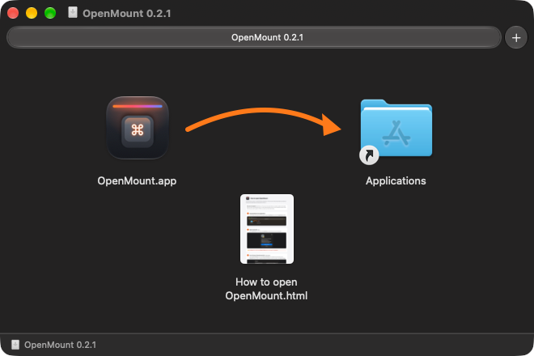
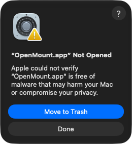
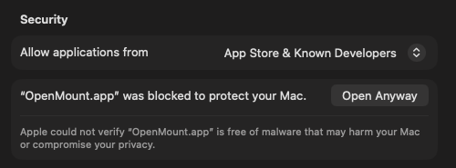
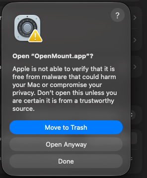
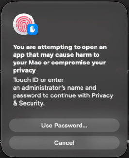
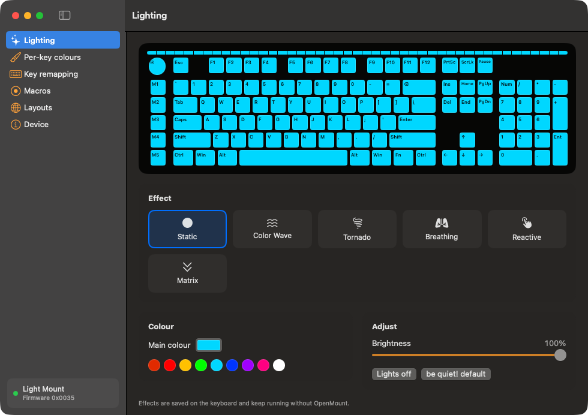

# How to install and open OpenMount

The first time you open OpenMount, macOS blocks it. **That's normal**, and you only need to do this
once per version (about a minute).

> **Why?** OpenMount is a free, open-source app. Apple only lets apps skip this check if the
> developer pays for a yearly Apple developer account. The full source code is in this repository,
> so anyone can check what it does.

Screenshots are from macOS 27; recent versions look the same.

## 1. Drag OpenMount into Applications

Open the downloaded **`OpenMount-…dmg`**. In the window that appears, drag **OpenMount** onto
**Applications**.



## 2. Open it, then click **Done**

Open **Applications** and double-click **OpenMount**. macOS says it was *Not Opened*.



> ⚠️ Click **Done**. Don't click the blue **Move to Trash** button, even though it's highlighted.

## 3. Privacy & Security → **Open Anyway**

Open **System Settings → Privacy & Security** and scroll down to **Security**. Next to
*"OpenMount.app" was blocked to protect your Mac*, click **Open Anyway**.



> 💡 The button is only shown for about an hour after step 2. If it's missing, open OpenMount
> again and repeat step 2.

## 4. Confirm with **Open Anyway**, then Touch ID or your password

 

> ⚠️ Again, **Move to Trash** is the highlighted button. Pick **Open Anyway** (the middle one).

## ✓ Done

OpenMount opens. Plug in your Light Mount and it connects automatically. You won't see these
warnings again for this version.



---

**Prefer Terminal?** After step 1, this removes the "downloaded from the internet" flag from
OpenMount only:

```sh
xattr -dr com.apple.quarantine /Applications/OpenMount.app
```

**After an update:** a new version is a new download, so repeat steps 2–4. Your keyboard settings
are stored on the keyboard and aren't affected.
